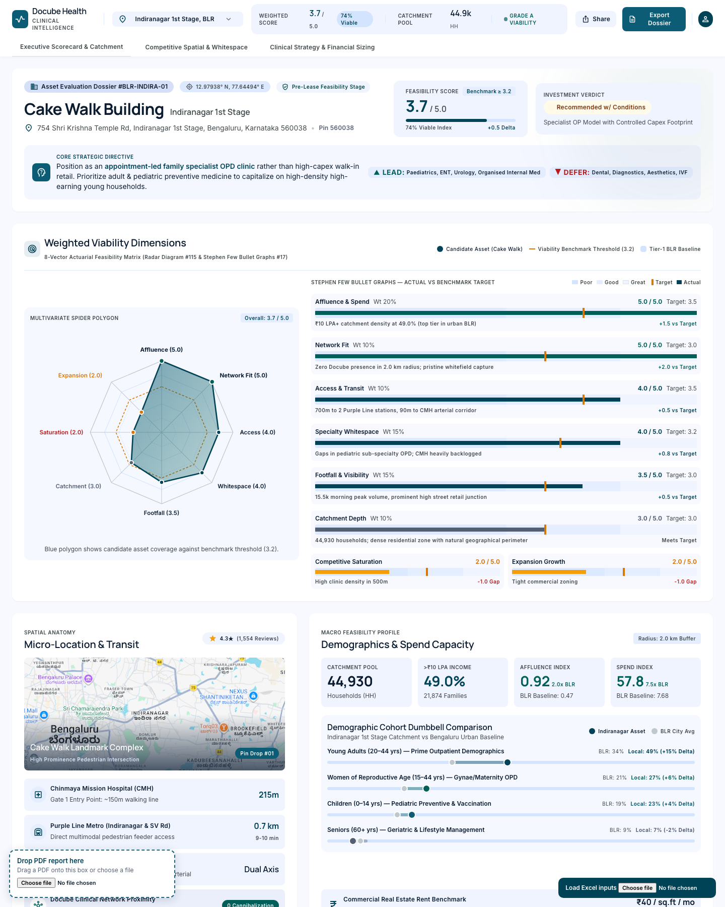
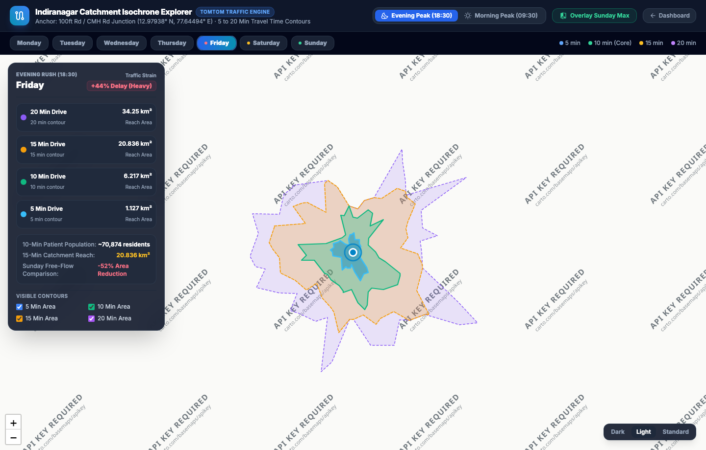

# 🏥 Docube Healthcare — Clinic Expansion Intelligence Dashboard

An executive-grade, interactive geospatial and actuarial analytics dashboard engineered for evaluating healthcare clinic expansion, competitive catchment dynamics, real-time traffic isochrones, and clinical viability across key metropolitan micromarkets.

---

## 🌐 Live Web Demos (Open in Browser)

- 🔗 **Full Clinic Expansion Dashboard**: [https://spkumar944.github.io/clinic-expansion-dashboard/](https://spkumar944.github.io/clinic-expansion-dashboard/)
- 🗺️ **Indiranagar TomTom Isochrone Catchment Explorer**: [https://spkumar944.github.io/clinic-expansion-dashboard/maps/indiranagar_isochrone_explorer.html](https://spkumar944.github.io/clinic-expansion-dashboard/maps/indiranagar_isochrone_explorer.html)

---

## 📸 Dashboard Interface Preview

---

## 🌟 Key Capabilities

### 1. Multi-Location Portfolio Switcher
Evaluate 5 prime clinic locations with instantaneous recalculation of viability scores, demographic factors, and patient catchment pools:
- **Indiranagar 1st Stage, BLR** (Benchmark Score: 3.7 / 5.0 · 74% Viable)
- **Koramangala 5th Block, BLR**
- **Whitefield Main Road, BLR**
- **Hitech City, Hyderabad**
- **Anna Nagar West, Chennai**

### 2. Dual Synchronized Spatial Demand Surfaces
- **Store Location & Footfall Map (Blue Spectrum)**: Displays clinic anchor pin, 2km primary catchment radius, and hexagonal demand density gradients.
- **Competitor Landscape Map (Red Spectrum)**: Highlights individual healthcare provider POIs with specialized tooltips and competitor gravity load.
- **Bidirectional Camera Synchronization**: Pan or zoom either map, and the opposing map glides in lockstep.

### 3. Continuous 10-Minute Slender Capsule Timeline Heatbars
- **Operating Hours**: 06:00 to 23:00 (103 discrete 10-minute micro-intervals).
- **Interactive Time Navigation**: Click any capsule to immediately shift the slider and refresh map demand surfaces.
- **Deep Tone Peak Indicators**:
  - *Store Footfall*: Soft ice blue (`#e0f2fe`) → Royal blue (`#2563eb`) → Midnight navy (`#172554`).
  - *Competitor Load*: Soft rose (`#fee2e2`) → Crimson (`#dc2626`) → Dark burgundy (`#7f1d1d`).

### 4. Competitor Gravity & Catchment Volume Bubble Chart
- **X-Axis**: Catchment Proximity Radius (`0 – 6 km`).
- **Y-Axis**: Daily Outpatient Footfall (`0 – 600 OPD/day`).
- **Bubble Radius**: Proportional to healthcare facility bed capacity:
  - `< 25 Beds`: Primary clinics & day centers
  - `50 – 100 Beds`: Nursing homes & multi-specialty centers
  - `> 150 Beds`: Major tertiary & anchor hospitals
- **Rich Interactive Tooltips**: Hover over any facility to view exact proximity, volume, and bed categorization.

### 5. Concentric Ring Actuarial Matrix
- **Epicenter (≤ 500m)**: 108 POIs · 138/km² core density (2.6x outer baseline).
- **Middle Catchment (500m – 1km & 1km – 1.5km)**: High density corridor transition.
- **Perimeter Base (1.5km – 2km)**: 53/km² peripheral baseline.
- **Elasticity Decay**: Distance elasticity rate calculation (-0.62 / 500m).

---

## 🚦 TomTom Traffic Catchment Isochrone Explorer

Explore how real-time and historical traffic congestion across **all 7 days of the week** affects patient travel times and catchment reach.

| Day of Week | 5 Min Reach | 10 Min Reach (Primary) | 15 Min Reach | 20 Min Regional Draw | Reachable Population (10 Min) |
| :--- | :---: | :---: | :---: | :---: | :---: |
| **Monday** | 1.12 km² | 6.00 km² | 20.31 km² | 34.08 km² | ~68,400 |
| **Wednesday** | 1.06 km² | 5.40 km² | **18.92 km²** | **31.69 km²** | ~61,500 (Most Constrained) |
| **Friday** | 1.13 km² | 6.22 km² | 20.84 km² | 34.25 km² | ~70,900 |
| **Sunday (Max)**| **1.36 km²** | **9.82 km²** | **29.61 km²** | **63.28 km²** | **~112,000** |

---

## 🛠️ Technology Stack
- **Frontend Core**: Pure Single-Page Application (SPA) with zero-build architecture.
- **Mapping & Geospatial**: Leaflet.js 1.9.4, CartoDB Positron & Dark Matter basemaps, OpenStreetMap.
- **Charts & Data Visualization**: Chart.js 4.4.7.
- **Styling**: Tailwind CSS (JIT runtime) + Google Inter & Material Symbols.
- **Traffic Intelligence**: TomTom Traffic Flow, Incidents & Routing APIs.
- **Hosting**: GitHub Pages (Free CDN & HTTPS distribution).

---

## 📄 License
MIT License. Created for Docube Healthcare Clinical Intelligence & Expansion Planning.
